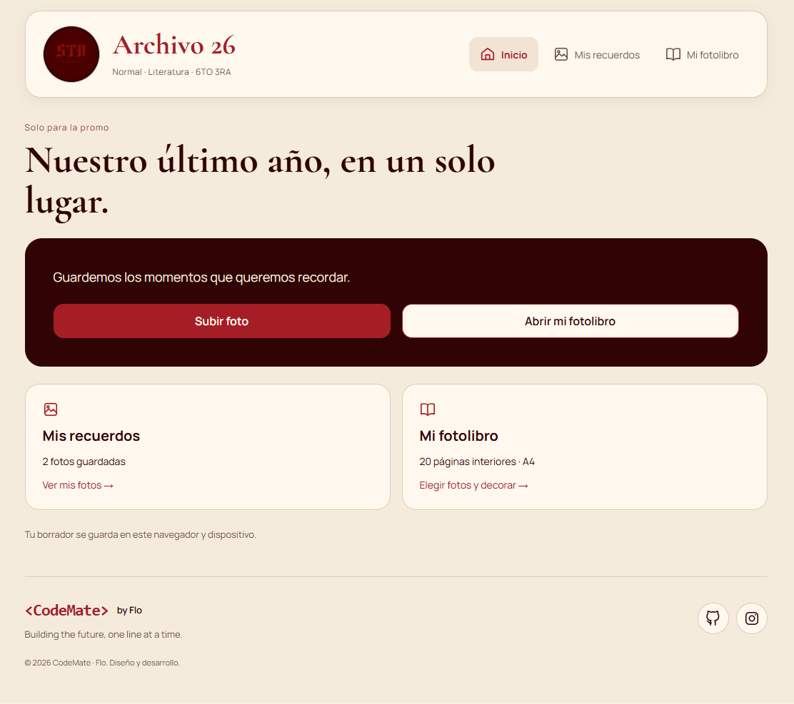
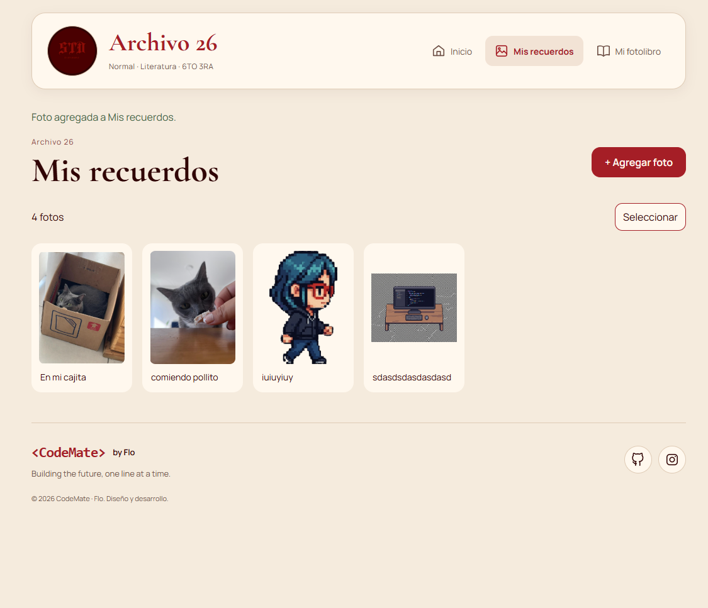
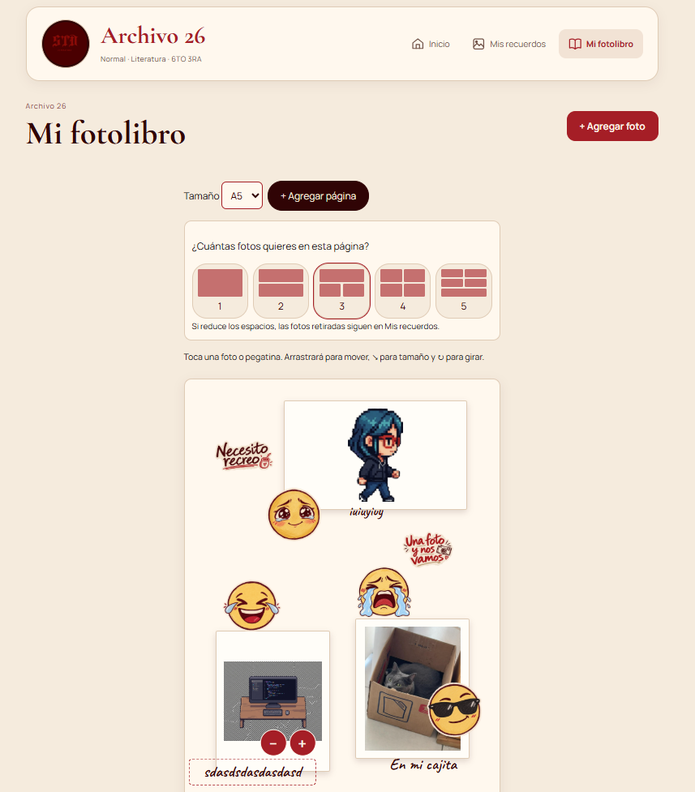
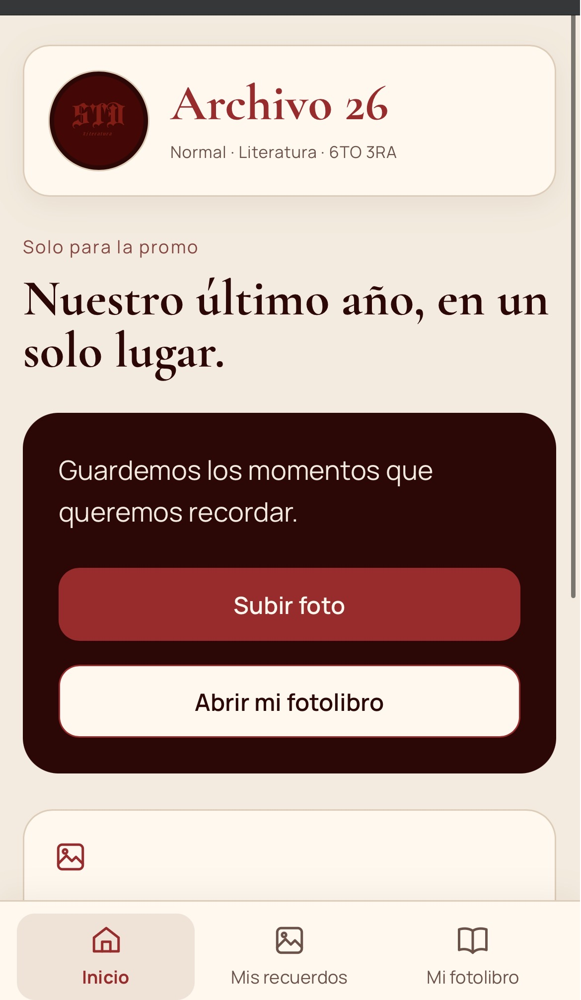
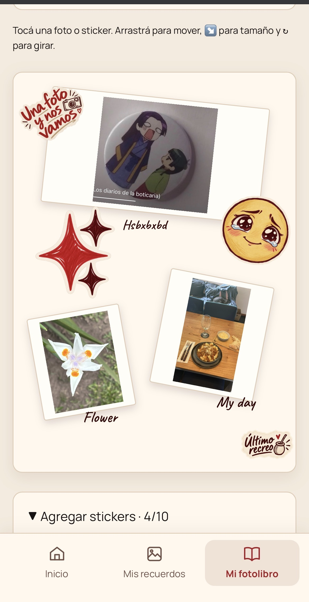
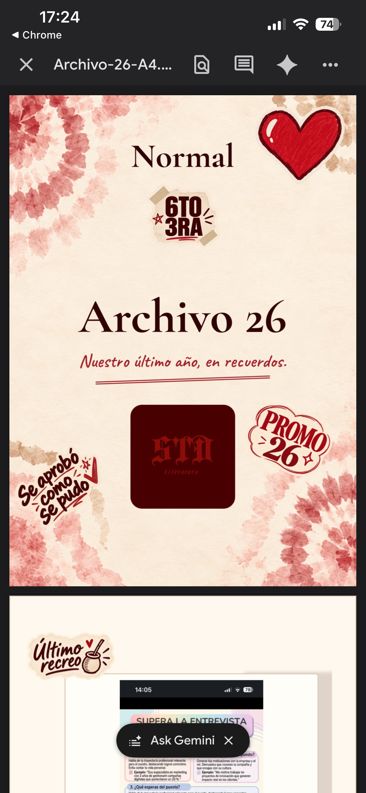

# Archivo 26

[English](#english) · [Español](#español)

## English

### About the project

Archivo 26 is a web application for the graduating class **Normal · Literatura · 6TO 3RA**, from Olavarría, Argentina.

It allows students to collect photos, add captions and create a personalized photo book with stickers, ready to download as a PDF.

The project combines photography, visual design and frontend development to preserve memories from the final school year.

**Status:** in development. The current version runs locally and saves drafts in the browser.

### Features

- Upload JPG, PNG and WebP images from a computer or phone.
- Compress photos to a maximum of 800 KB and 1600 pixels on their longest side.
- Add captions of up to 150 characters.
- Browse photos in a gallery and select multiple memories for deletion.
- Start with 20 interior pages, a front cover and a back cover.
- Add or remove interior pages.
- Choose between 1 and 5 photos per page.
- Move, resize and rotate photos and their frames.
- Move and resize captions while keeping the text horizontal.
- Add up to 10 stickers to each page, including the covers.
- Move, resize, rotate and remove stickers.
- Customize the front cover phrase.
- Choose A4 or A5 format and download the photo book as a PDF.
- Restore the draft after reloading the page in the same browser and device.

### Screens

**Home**

Project introduction and quick access to photo uploads, the gallery and the photo book.

**My memories**

Photo gallery with captions and selection controls. New photos are added through a panel with a preview and compression information.

**My photo book**

An editor displaying one page at a time, with photo layouts, stickers, editing controls and PDF download.

Navigation appears at the bottom on mobile and at the top on desktop.

### Screenshots

These screenshots show the current development version. Photos and captions are sample content used for testing.

#### Desktop · Home



#### Desktop · My memories



#### Desktop · Photobook editor



#### Mobile · Home



#### Mobile · Photobook editor



#### Downloaded PDF



#### Desktop home


#### My memories


### Technologies

| Technology | Purpose |
| --- | --- |
| React and JavaScript | Interface, screen navigation and editor state |
| Vite | Development server and production build |
| CSS | Responsive layout, covers and editor controls |
| IndexedDB | Local draft storage |
| browser-image-compression | Photo compression |
| html-to-image | Page capture for PDF export |
| jsPDF | PDF generation |
| Sharp | Sticker asset optimization during development |
| ESLint | Code analysis |

### Run locally

You need Node.js, npm and Git installed.

```bash
git clone https://github.com/devCODEMATE/archivo-26.git
cd archivo-26
npm install
npm run dev
```

Open the **Local** address displayed by Vite in the terminal. It is usually:

```text
http://localhost:5173/
```

#### Test on a phone

Connect your computer and phone to the same Wi-Fi network and run:

```bash
npm run dev -- --host
```

Open the **Network** address shown in the terminal using your phone’s browser.

Keep the development server running and the computer turned on during the test.

### Available commands

| Command | Purpose |
| --- | --- |
| `npm run dev` | Start the development server |
| `npm run lint` | Check the code with ESLint |
| `npm run build` | Generate the production build in `dist/` |
| `npm run preview` | Preview the production build locally |

To optimize sticker images:

```bash
node scripts/optimize-stickers.mjs
```

The script keeps a copy of the original images in:

```text
backups/stickers-originals/
```

### Project structure

```text
docs/
  images/               Screenshots for documentation
public/
  marca/                Logo and cover backgrounds
  stickers/promo/       Sticker images
scripts/
  optimize-stickers.mjs
src/
  components/           Editor, pages, covers and editable elements
  stickers/             Sticker catalog
  storage/              IndexedDB storage
  utils/                PDF export and supporting functions
  App.jsx               Main screens and application state
  App.css               General styles
  AppScreens.css        Navigation, gallery and upload panel
  BookEditor.css        Photo book editor styles
  CoverDesign.css       Front and back cover styles
```

### Storage and current scope

Drafts are stored in **the browser and device where they are created**.

The current version does not include user accounts, synchronization between devices or a shared gallery for the class.

Photos added through the interface are not uploaded to GitHub. The repository contains the source code, brand assets and stickers.

Clearing the website’s browser data may remove the local draft. Downloading the PDF allows users to keep a copy of the finished photo book.

### Roadmap

- [x] Photo upload, compression and captions.
- [x] Gallery with selection and deletion controls.
- [x] Per-page photo layouts.
- [x] Editable photos, stickers and captions.
- [x] Branded front and back covers.
- [x] Local draft storage.
- [x] A4 and A5 PDF export.
- [x] Separate Home, My memories and My photo book screens.
- [x] CodeMate footer with GitHub and Instagram links.
- [ ] Expand testing across devices and browsers.
- [ ] Refine typography, controls and visual details.
- [ ] Implement access and shared storage for the class.
- [ ] Publish the application with HTTPS.
- [ ] Add PWA installation.
- [ ] Run a trial with students before launch.

### Author

Designed and developed by **Flo · CodeMate**.

*Building the future, one line at a time.*

[GitHub](https://github.com/devCODEMATE) · [Instagram](https://www.instagram.com/dev.codemate/)

---

## Español

### Sobre el proyecto

Archivo 26 es una aplicación web para la promo **Normal · Literatura · 6TO 3RA**, de Olavarría, Argentina.

Permite reunir fotos, agregar descripciones y crear un fotolibro personalizado con stickers, listo para descargar en PDF.

El proyecto combina fotografía, diseño visual y desarrollo frontend para conservar los recuerdos del último año escolar.

**Estado:** en desarrollo. La versión actual funciona de forma local y guarda los borradores en el navegador.

### Funcionalidades

- Agregar imágenes JPG, PNG y WebP desde la computadora o el celular.
- Comprimir las fotos hasta un máximo de 800 KB y 1600 píxeles en su lado mayor.
- Agregar descripciones de hasta 150 caracteres.
- Ver las fotos en una galería y seleccionar varios recuerdos para eliminarlos.
- Comenzar con 20 páginas interiores, tapa y contratapa.
- Agregar o quitar páginas interiores.
- Elegir entre 1 y 5 fotos por página.
- Mover, cambiar el tamaño y girar las fotos y sus marcos.
- Mover y cambiar el tamaño de las descripciones, manteniendo el texto horizontal.
- Agregar hasta 10 stickers por página, incluidas la tapa y la contratapa.
- Mover, cambiar el tamaño, girar y eliminar stickers.
- Personalizar la frase de la tapa.
- Elegir formato A4 o A5 y descargar el fotolibro en PDF.
- Recuperar el borrador al recargar la página en el mismo navegador y dispositivo.

### Capturas de pantalla

Estas capturas muestran la versión actual en desarrollo. Las fotos y las descripciones son contenido de prueba.

#### Escritorio · Inicio


#### Escritorio · Mis recuerdos


#### Escritorio · Editor del fotolibro


#### Celular · Inicio


#### Celular · Editor del fotolibro


#### PDF descargado


### Tecnologías

| Tecnología | Uso |
| --- | --- |
| React y JavaScript | Interfaz, navegación y estado del editor |
| Vite | Servidor de desarrollo y compilación |
| CSS | Diseño adaptable, tapas y controles del editor |
| IndexedDB | Guardado local del borrador |
| browser-image-compression | Compresión de las fotos |
| html-to-image | Captura de las páginas para exportar |
| jsPDF | Generación del PDF |
| Sharp | Optimización de los stickers durante el desarrollo |
| ESLint | Análisis del código |

### Ejecutar de forma local

Necesitás Node.js, npm y Git instalados.

```bash
git clone https://github.com/devCODEMATE/archivo-26.git
cd archivo-26
npm install
npm run dev
```

Abrí la dirección **Local** que muestre Vite en la terminal. Habitualmente es:

```text
http://localhost:5173/
```

#### Probar desde el celular

Conectá la computadora y el celular a la misma red Wi-Fi y ejecutá:

```bash
npm run dev -- --host
```

Abrí en el navegador del celular la dirección **Network** que aparece en la terminal.

Mantené el servidor de desarrollo y la computadora encendidos durante la prueba.

### Comandos disponibles

| Comando | Uso |
| --- | --- |
| `npm run dev` | Iniciar el servidor de desarrollo |
| `npm run lint` | Revisar el código con ESLint |
| `npm run build` | Generar la compilación de producción en `dist/` |
| `npm run preview` | Previsualizar la compilación de forma local |

Para optimizar los stickers:

```bash
node scripts/optimize-stickers.mjs
```

El script conserva una copia de las imágenes originales en:

```text
backups/stickers-originals/
```

### Estructura del proyecto

```text
docs/
  images/               Capturas para la documentación
public/
  marca/                Logo y fondos de las tapas
  stickers/promo/       Imágenes de stickers
scripts/
  optimize-stickers.mjs
src/
  components/           Editor, páginas, tapas y elementos editables
  stickers/             Catálogo de stickers
  storage/              Guardado con IndexedDB
  utils/                Exportación del PDF y funciones auxiliares
  App.jsx               Pantallas y estado principal
  App.css               Estilos generales
  AppScreens.css        Navegación, galería y panel de carga
  BookEditor.css        Estilos del editor
  CoverDesign.css       Estilos de tapa y contratapa
```

### Guardado y alcance actual

Los borradores se guardan en **el navegador y dispositivo donde se crean**.

La versión actual no incluye cuentas de usuario, sincronización entre dispositivos ni una galería compartida para la promo.

Las fotos agregadas desde la interfaz no se suben a GitHub. El repositorio contiene el código, los recursos de marca y los stickers.

Si se borran los datos del sitio en el navegador, se puede perder el borrador local. Descargar el PDF permite conservar una copia del fotolibro terminado.

### Roadmap

- [x] Carga, compresión y descripción de fotos.
- [x] Galería con selección y eliminación de recuerdos.
- [x] Distribución de fotos por página.
- [x] Fotos, stickers y descripciones editables.
- [x] Tapa y contratapa con identidad visual de la promo.
- [x] Guardado local del borrador.
- [x] Exportación a PDF en A4 y A5.
- [x] Pantallas separadas de Inicio, Mis recuerdos y Mi fotolibro.
- [x] Footer de CodeMate con enlaces a GitHub e Instagram.
- [ ] Ampliar las pruebas en distintos dispositivos y navegadores.
- [ ] Pulir tipografías, controles y detalles visuales.
- [ ] Implementar acceso y almacenamiento compartido para la promo.
- [ ] Publicar la aplicación con HTTPS.
- [ ] Incorporar la instalación como PWA.
- [ ] Realizar una prueba con alumnos antes del lanzamiento.

### Autora

Diseñado y desarrollado por **Flo · CodeMate**.

*Building the future, one line at a time.*

[GitHub](https://github.com/devCODEMATE) · [Instagram](https://www.instagram.com/dev.codemate/)